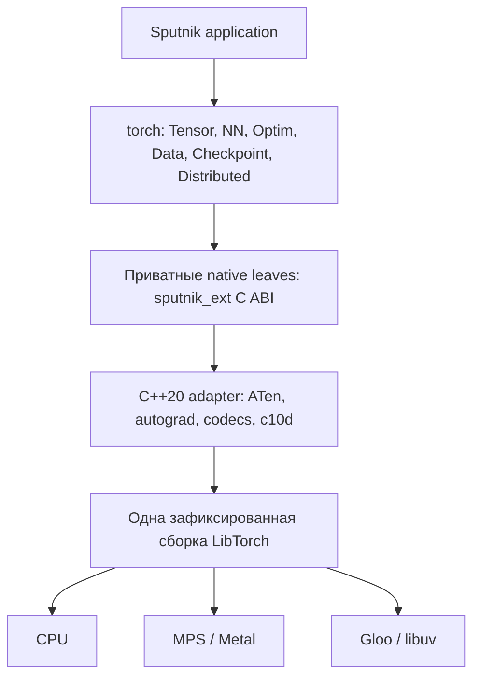

# Архитектура torch

> Целевой проект. Текущая реализация и ограничения: [implementation-status.md](implementation-status.md).

Статус: проект. Нормативные формулировки описывают будущую реализацию.

## 1. Границы и цели

Torch — eager tensor framework. Его ближайший ориентир — возможности
torch-rb плюс torch-ddp, адаптированные к Sputnik. Совместимость оценивается
по математическим операциям, gradients и форматам данных, а не по совпадению
имён каждого Python/Ruby метода.

В обязательную первую поставку входят CPU/MPS tensors, reverse-mode autograd,
достаточный NN-набор для MLP/CNN и небольшого Transformer, optimizers,
state dict/checkpoints, data loading, CPU/Gloo DDP и процессный launcher.
CUDA/NCCL предусматриваются архитектурой и реализуются после Mac baseline.
TorchDynamo, Inductor, Python callbacks, torch.compile, FSDP, RPC и общий
Python object loading в первую поставку не входят.

Опыт torch-rb подтверждает разделение native tensor bindings и библиотечного
слоя на языке-хозяине. Torch заимствует этот подход, но не Rice, Ruby
object model или monkey patches. [Torch.rb](https://github.com/ankane/torch.rb)

## 2. Слои

| Слой | Ответственность | Чего в нём нет |
| --- | --- | --- |
| Sputnik | Публичные классы, defaults, keywords, registry параметров, composition, validation, ошибки, эффекты | Указателей ATen, реализации tensor kernels |
| C ABI | Типизированные handles и примитивные значения, возврат faults | STL, C++ exceptions, Python/Ruby values |
| C++ adapter | ATen dispatch, ownership, autograd, native waits/hooks, decoder storage, c10d | Вызова произвольного Sputnik-кода из autograd workers |
| LibTorch | Storage, devices, kernels, graph engine, c10d | Sputnik module registry и публичной политики мутаций |

Логические модули: `torch`, `torch.nn`, `torch.nn.functional`,
`torch.optim`, `torch.data`, `torch.checkpoint`,
`torch.distributed`, `torch.backends`, `torch.random`,
`torch.testing`. Это модули одной версии пакета. Имя локального import
можно сократить до `torch` штатными средствами Sputnik.

## 3. Native ABI и lifetime

Опора — существующий [sputnik_ext.h](../../sputnik-lang/runtime/sputnik_ext.h).
`SputnikValue`, `SputnikCtx`, string/bytes views действуют только в рамках вызова.
Ни asynchronous kernel, ни native worker не сохраняет их после return.
Map/keyword/tree преобразования выполняются в Sputnik: ABI v1 предоставляет
primitive values, lists и handles, но не универсальный reader Sputnik-объектов.

| Native handle | Ownership | Содержимое/освобождение |
| --- | --- | --- |
| TensorCore | `collected` | `at::Tensor` по значению + пакетные guards; context-free release |
| GeneratorCore | `collected` | Native generator, lock и снимок device/config |
| GradientsCore / SnapshotCore | `collected` | Собственные native ссылки, без Sputnik closures |
| ProcessGroupCore / StoreCore | `owned` | Явный `close!`/scope; освобождение сети вне GC |
| DdpCore | `owned` | Регистрация hooks, reducer state, ссылки на parameters и group |
| WorkCore | `owned` | Незавершённая операция и сильные ссылки на её buffers |

WorkCore в `0.1` может оставаться приватной деталью синхронного wait path;
публичный asynchronous Work API вводится позднее.

`TensorCore` освобождает свою ссылку, а не принудительно освобождает общую
память. Autograd graph, views и backend удерживают необходимые native
ссылки. Reclaim не вызывает Sputnik, не делает distributed barrier и не
синхронизирует весь GPU. `destroy!` делает конкретный wrapper недоступным;
живой независимый wrapper/view остаётся валидным.

Публичный Tensor — обычный Sputnik-класс вокруг приватного TensorCore. Каждый
вход в C++ проверяет tag, lifetime, mutability и разрешённый thread/task
access. C++ exceptions ловятся внутри thunk и переводятся через `sputnik_fault`.
Для `std::bad_alloc`, c10 errors и неожиданных исключений есть отдельные
ветки; исключение никогда не выходит через C ABI.

Generic `deep_copy` Sputnik считает opaque resources atomic leaves. Поэтому
Tensor и Module обязаны реализовать собственные copy/`init_copy` contracts;
обычный рекурсивный copy wrapper-а не считается копированием tensor storage.
Основание: [спецификация Sputnik](../../sputnik-lang/sputnik_unified_final_spec.md).

## 4. Threading, tasks и режим autograd

ATen/C10 имеет собственные workers и thread-local execution state.
Sputnik strands могут выполняться на разных потоках, а native объявления с
`from "..." blocking` выносят вызовы в FFI executor. Поэтому нельзя установить `NoGradGuard` на
одном OS thread, выполнить произвольный Sputnik-блок и ожидать, что guard
распространится на все вызванные из него native операции.

Принимается следующее решение:

1. Grad/inference/autocast policy хранится как **логический task-local**
   execution context Sputnik. Default: grad enabled, autocast off.
2. Перед native dispatch runtime передаёт immutable snapshot контекста.
   В actual executing thread adapter создаёт и уничтожает RAII guards на
   каждый вызов; прежний TLS обязательно восстанавливается.
3. `no_grad`/`inference_mode` используют scoped replacement с `ensure`.
   Вложенные scopes и исключения восстанавливают прежнее состояние.
4. Spawn наследует snapshot policy, но не общий mutable RNG или process group.
   После создания child contexts независимы.
5. Autograd native workers получают нужное native execution state через
   штатный механизм LibTorch; callbacks в Sputnik из них запрещены.

Такого общего extension-context контракта в проверенном `sputnik_ext.h` нет.
Это обязательное расширение runtime перед выпуском scoped API. В первом
техническом spike context передаётся явным аргументом native leaf. Публичный
релиз не должен зависеть от временной привязки strand к OS thread.

Расширение context ABI оформляется версионированно: существующий ABI v1
нельзя молча переопределять. P1 фиксирует новую version/capability handshake
и минимальный Sputnik build для пакета; старый runtime отклоняется до запуска.
Spike с явно переданным контекстом не считается заменой этого контракта.

Вычислительные kernels и metadata вызываются прямо. `blocking` в объявлении
используется для file I/O, collective waits, materialize/transfer и явного
synchronize, которые могут ждать внешнее выполнение. Metadata `amt_info` и
`amt_synchronize` имеют разные bindings, поэтому чтение версии или количества
threads не переносится на worker вместе с синхронизацией.

CPU kernel занимает поток до возврата из C++. Для кооперативной VM task длинную
цепочку можно явно обернуть в `execution_batch`: вся цепочка уходит на FFI worker
одним вызовом, а внешний task паркуется. Native сохраняет C++ стек async-задачи
на отдельном host thread и паркует scheduler strand; ожидание future происходит
вне scheduler worker. Этот driver включается для программ с blocking bindings
и пока стоит одного host thread на активную async-задачу. Перенос не ускоряет
CPU вычисление. Размечать каждый короткий
kernel как `blocking` создаёт лишние переходы и очереди. GPU launch не равен
завершению GPU: входные native references удерживаются backend-ом до окончания работы.

Cancellation cooperative: опрашивается `sputnik_task_cancelled`; монолитный
kernel/collective может не поддерживать немедленное прерывание. Отменённая
операция не позволяет освободить используемый ею buffer до завершения native
work. Для Gloo обязательны timeout и завершение всей failed worker group.

DataLoader использует no-GIL Sputnik tasks: dataset и готовые batches, включая
Tensor, передаются по ссылке в одном процессе через очереди под Mutex.
Каналы передают только сигналы готовности; сериализация и копирование
storage для передачи не нужны. Worker после публикации batch не меняет его,
потребитель получает тот же объект. Shared dataset/collate должны допускать
параллельный доступ; concurrent mutation storage, Module, Optimizer или
общего RNG требует явной синхронизации. [Контракт DataLoader](data-loader.md).

## 5. Effects и capabilities

Используем существующие labels `alloc`, `mut`, `ffi`, `gpu`, `fs`, `net`,
`random`, `async`, `env`; новые слова в effect language не нужны.
`!` в имени отвечает за видимость мутации, а effect row — за остальные
эффекты. Non-bang tensor op не объявляется `!{}`: он как минимум может
выделять память и обращаться к FFI/GPU.

Bindings имеют явные effect summaries. Грубые heuristics checker-а не
считаются достаточным доказательством чистоты native call. Путь вызова
блока учитывает эффекты блока; `no_grad` не делает блок pure.
Основание: [effects-v1](../../sputnik-lang/docs/engineering/effects-v1.md).

Filesystem checkpoint I/O требует соответствующей capability, distributed
— network/process permissions языка. Device capability проверяется отдельно
от наличия нужного символа в LibTorch. Если соответствующая проверка пока
не выражается в ABI, она входит в runtime integration gate, а не обходится.

## 6. Генерация bindings

База генерации — operator schemas выбранной версии PyTorch; источник
фиксируется commit/hash. Аналогичный подход виден в `codegen/` исходного
[torch-rb 0.25.0](https://rubygems.org/gems/torch-rb/versions/0.25.0).

Python запрещён как зависимость пакета, сборки, генерации bindings и тестов.
Текущий набор bindings написан вручную. Будущий генератор будет
читать проверенный schema export на C++ или Sputnik; `torchgen` не запускается
сборкой torch. Split строк/регулярные выражения не заменяют parser схем.
Генерируемые артефакты поставляются с пакетом.

Для каждой разрешённой операции хранится reviewable entry: upstream schema,
Sputnik name/signature, input/output types, mutation targets, alias sets,
autograd support, dtype/device coverage, effects, return policy и tests.
Выход: `.s` declarations, C ABI thunks, registration table, docs inventory,
compile checks. Публичная поверхность — allowlist.

Недостаточно заменить trailing `_` на `!`. Schema-аннотации alias/write,
`out` arguments, hidden buffers и non-tensor state анализируются отдельно.
`out:` не допускается у обычной non-bang функции. Metadata/view ops,
`resize_`, `set_`, storage APIs, multi-out и unsafe ops не экспортируются
автоматически. Для обычных overloads выбирается один Sputnik keyword API;
динамический диспетчер тысяч строковых имён не является публичным интерфейсом.

## 7. Зависимости и поставка

Sputnik-приложение содержит скомпилированный Sputnik и adapter; LibTorch — shared
dependency с зафиксированным build identity. В одном процессе допустима
только одна копия совместимого LibTorch. Его внутренний C++ ABI не
объявляется стабильным вслед за Sputnik C ABI.

Package lock дополняется native build lock: upstream tag/SHA/submodules,
patches, toolchain, SDK, target, flags, TorchConfig fingerprint и хеши
артефактов. Отдельные build features меняют build identity, но не создают
отдельный пользовательский пакет `torch-ddp`.

## 8. Проверенные ограничения Sputnik и обязательные изменения

| Наблюдение в текущем коде | Решение перед использованием |
| --- | --- |
| Native units стартуют с `-std=c++17`; отдельный `cxxflags` существует | Для spike возможен explicit `-std=c++20`; для поддерживаемого пути — поле language standard и проверка compatibility |
| `library_dirs` и `runtime_library_dirs` добавлены в executable/VM link paths и package digests | Полный prebuilt external-artifact contract и relocatable bundle ещё требуют реализации |
| `SputnikValue` и borrowed bytes ограничены временем вызова | Копировать bytes; никакого `from_blob` поверх временного Sputnik buffer |
| Есть blocking executor и cancellation reader | Использовать; отдельно проверить context propagation и lifetime на cancel |
| Нет extension task-local context API | Добавить per-call context snapshot и scopes с exception-safe restore |
| Native pointer reader проверяет tag/tombstone, но не полный tensor alias/mutation contract | Guards wrapper + adapter; проверить frozen dispatch, native views и copy hooks end-to-end |
| Error classes доступны пакетам | Объявить публичную иерархию и проверить typed rescue в native executable |

Конкретные основания: [PackageNativeExtension](../../sputnik-lang/package/package.h),
[build driver](../../sputnik-lang/tools/sputnik/main.cpp),
[ABI implementation](../../sputnik-lang/runtime/sputnik_ext.cpp),
[sqlite3 package](../../sqlite3-sputnik/src/sqlite3.s).
Исторические DESIGN/RFC поясняют намерения; фактическое наличие возможностей
определяется текущим кодом и отдельным integration test.
